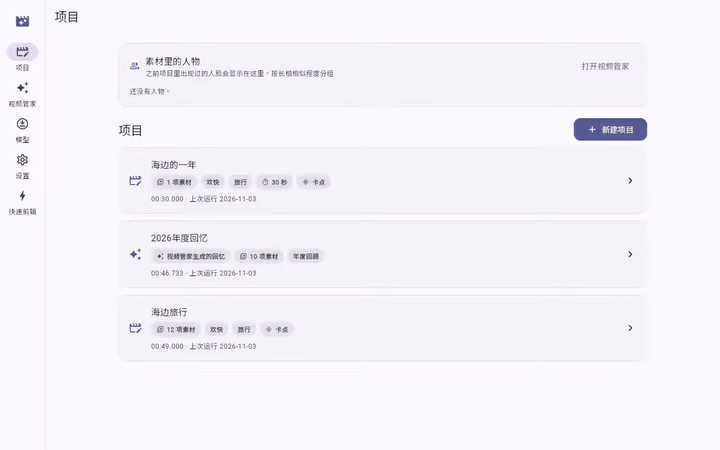
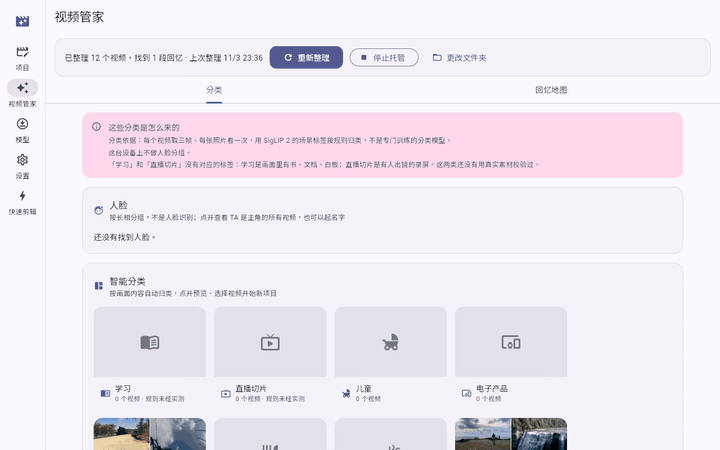
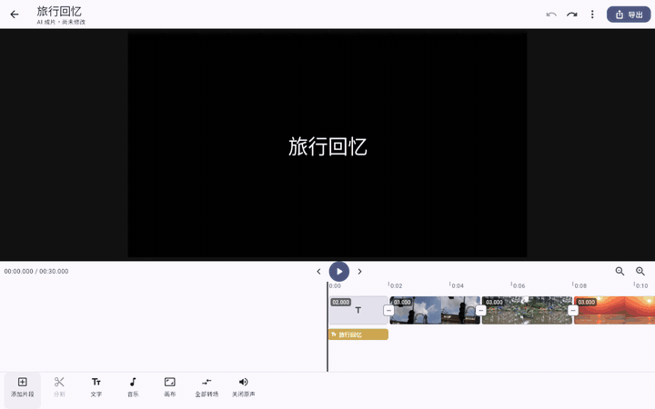
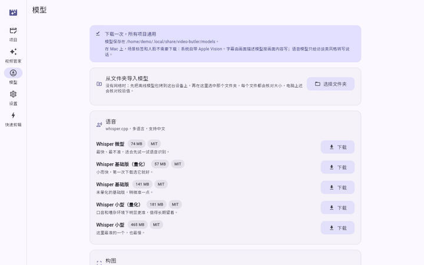

<div align="center">

<!-- TODO: There is no logo in the repo yet. When one exists, put it here, for example . Do not link an image that is not in the tree. -->

# 🎬 Video Butler · 视频管家

**A free, local AI video butler — deployable on an ordinary phone!**

This project helps users deploy free AI onto their mobile devices to edit private videos and photos fully automatically, on the device, saving precious storage space and users' time.

[](LICENSE)
[](https://github.com/charlesbuling/VideoButler/releases/tag/v0.2.0)
[](https://github.com/charlesbuling/VideoButler/releases)
[](#download)
[](#privacy)
[](https://github.com/charlesbuling/VideoButler/stargazers)

[📥 Download](#download) · [✨ What it does](#features) · [🚀 Quick start](#quickstart) · [🛠️ Build from source](#build) · [中文](README.md) | English



</div>

Video Butler is a "personal editing assistant" that lives on your own phone and computer. Tell it which folder your footage is in, and it watches hundreds or thousands of videos and photos right on the device: which are scenery, which are food, which are your kids, which belong to one trip, which seconds are steady, well lit and unblocked. Then, following the mood and topic you choose, it picks segments, orders them and cuts on the beat to produce a decent rough cut.

It is made for everyone who shoots a lot and edits little: travellers with no time to edit, new parents worn out by childcare who still want to record their baby growing up, and anyone whose camera roll is full but who can't bear to delete a single memory. You don't need editing skills, and you don't need an expensive new computer — a phone or computer from two years ago is enough to run it.

We stay **free, local and private**: the software is open source and free, and the models it uses are freely available open models. Analysis and editing happen entirely on your device; footage is not uploaded, no telemetry is collected, and it can produce a cut offline. Most importantly, the AI hands you **not a flattened, burned-in final video, but a draft you can keep editing at any time** — every cut, caption and transition can be adjusted in the app, or exported to Jianying (CapCut) or another professional editor for finishing. The machine does the tedious eighty percent; the last twenty percent, the part that carries your heart, stays with you.

---

# 💡 Why this exists

### Reason one: storage is the real reason we upgrade

Lately, for reasons everyone knows, computers and phones have been getting more expensive. Yet look at the phone or computer you bought two years ago: its compute still fully meets daily needs — scrolling videos, taking photos, office work, no lag at all. What really pushes many people to upgrade is often just one message: "Storage full" — and most of that space is taken by videos and photos. I have been there too, picking through photos one by one at that pop-up, deleting until my hands are tired and still unable to let go. A cloud drive looks like a way out, but the monthly subscription adds up over the years, and putting the most private images of your kids, your family and yourself on someone else's server never feels quite right. So I wondered: could the device itself turn mountains of raw footage into compact edited keepsakes? That would free up space without losing a single memory.

### Reason two: by the last night of the trip, the video should be done

On many trips I have shot a huge amount: sunrises, street scenes, food, friends running and laughing on the beach… But the schedule is packed — on the road all day, asleep the moment you lie down — so there is no time to edit. Back home, hundreds of clips sit quietly in the camera roll, the excitement cools day by day, and they are never opened again. I have always wanted software like this: on the last night of the trip, back at the hotel, I plug in my phone and let it organise everything; when I wake up the next morning, all the footage has become a travel video with music, cut on the beat. I tweak it a little and post it straight to WeChat Moments and Douyin, sharing the joy while everyone still remembers it!

### Reason three: every day of the baby's life deserves to be remembered

We recently welcomed a baby into the family. Only as a parent do you realise how fast children grow: the first laugh out loud, the first roll-over, the first time standing up holding the sofa — these moments flash by and never come back once missed. So the phone, the action camera and the home security camera keep shooting and recording every day, and the footage, scattered across several devices, keeps piling up. But new parents are exhausted from feeding and getting the baby to sleep, there is simply no time to edit day to day, and yet we truly want to record every moment of the baby growing up. I want a butler that finds today's cutest few seconds in that footage on its own, and strings our child's growth into a story, day by day.

### So: Video Butler

For these reasons, this project uses local models that the phone and computer in your hands can run to build a "video butler" framework that classifies, stores, edits and exports locally, while keeping a second, finer edit possible:

- **Classify**: footage is sorted by picture content into scenery, transport, food, animals, children, gatherings and more; faces are grouped by look; and "memories" such as a trip, a year in review or a child growing up are found automatically.
- **Store**: footage is read in place, originals are never copied or modified; analysis, face groups and memories are kept only on this device, and the next pass only handles new footage.
- **Edit**: pick a mood and a topic, decide whether to cut on the beat, and it avoids shaky, over-exposed and blocked frames, picks good shots and lays out a rough cut automatically.
- **Export**: the draft can become a Jianying / CapCut draft or an OpenTimelineIO file, and on macOS it can be rendered straight to MP4; a cut that only trims can be exported losslessly, with no loss of quality.
- **Second, finer edit**: the AI only gives you a starting point; in the built-in editor you can keep splitting, changing speed, adding text, swapping music, undoing and redoing, and your edited version is not overwritten by the next automatic run.

Once installed, here is what you can do 👇

---

<a id="features"></a>

# ✨ What you can do with it

> Only what 0.2.0 already does is listed here. Items marked **🧭 Planned** are not finished; exactly what each platform lacks is in the [status](#status) table below.

### 🗂️ One-click butler: footage sorts itself

Point it at a folder, tap "一键托管" (one-click butler), and leave the rest to Video Butler. No more hunting through thousands of files for one clip: open a category, a person or a memory, and what you want is right there.

- **Automatic categories by what is in the picture**: scenery, transport, food, animals, children, group gatherings… The software looks at the picture itself, not the file name. Open a category to preview its clips, tick a few, and start a new editing project.
- **Faces grouped by look**: the same person across different videos lands in the same group. This is grouping, not recognition, and never linked to any outside identity. Name each group — "Baby", "Dad" — and open it to see every video where that person is the star.
- **Memories found for you**: a trip, a child growing up, a year in review, people who often appear together — Video Butler finds them on its own. Each memory can **become an editing project in one click** and is cut into a draft in the background, one after another, ready when you come back.
- **Memory map**: memories with a location are pinned on an **offline** world map, filterable by category, so you can see at a glance where you have been and what you left there. The base map is Natural Earth's public-domain data; no network.
- **Originals untouched**: footage is read in place, never copied or modified, so it takes no extra space; the next organise pass only handles new or changed files, so it gets faster the more you use it.

<div align="center">

</div>

<!-- TODO recording: face grouping (macOS or an Android phone recommended, with your own or consented footage, 8–12 s), file docs/assets/faces.gif -->

### ✂️ Pick a style, get a rough cut

No editing skills needed: pick a style, tap "生成草稿" (generate draft), and hundreds of clips become a short film with rhythm and shape.

- **Mood × topic**: choose a **mood** (happy / sad / funny) × a **topic** (travel, growing up, dance, year in review, people memories…), then decide whether to **cut on the beat**. The software picks segments from scenes and orders them by that style; the same footage in another style has a different flavour.
- **Beat cuts**: the beat is read from music you import or from the footage's own sound, and every cut lands on a beat, so the picture moves with the music.
- **Good shots**: shaky, over-exposed and blocked frames are avoided automatically, keeping the steadiest, brightest, clearest seconds; with the matching models installed it also weighs depth, faces, people and pose.
- **Picture captions**: with Qwen3-VL installed, each chosen segment gets a caption describing **what is in the picture**, not a transcript of holiday chatter; with Whisper installed, speech can become timestamped subtitles.
- **Dance and subject continuity**: by body pose, several takes of the same action are joined on one timeline so the motion flows across each cut, as if it were one continuous shot.
- **Photos too**: photos join the scenes of videos shot at the same time, mixed into one draft, so snapshots from the trip are not left behind.
- **Every cut has a reason**: the result page says why each segment was chosen and which models did not run. Edit instructions must match real shots and timecodes; ones that do not are rejected, not quietly "fixed". Every cut you see comes from footage you really shot.
- **Saves more time the more you use it**: a second run reuses the analysis already done and only processes newly added footage, so trying another style doesn't mean waiting from scratch.

### 🎬 Keep refining in the app

The AI only gives you a good starting point. Open the built-in editor and keep going, much as you would in Jianying, until the video is truly yours.

- **Editing**: split, trim, reorder, duplicate, delete; **speed 0.25–4×**, to slow down your child's smile or speed through travel shots; volume and mute; transitions.
- **Picture and packaging**: position / scale / rotation, crop, brightness / contrast / saturation, background, text, music, canvas ratio — switch between landscape and portrait at will.
- **Edit fearlessly**: the whole draft has **undo / redo (200 steps)**; generating a new rough cut **does not overwrite the version you edited** — you are told a new version is available, so your work is never washed away.

<div align="center">

</div>

### 📤 Export to where you already work

Once it's cut, you decide where it goes: keep polishing in software you know, or take the finished video and share it.

- **剪映专业版 (Jianying Pro) / CapCut drafts**: written straight into the draft folder Jianying reads; restart Jianying and it is there, with clips, transitions, crops, caption styles, filters and music, ready to keep editing.
- **OpenTimelineIO (`.otio`)**: for other professional editors; also works on platforms without Jianying (such as Linux).
- **Rendered MP4** (macOS, H.264 / HEVC + AAC, hardware encoding), ready to post.
- **Lossless export**: a cut that only trims copies the original data without re-encoding, so there is zero quality loss; segments can also be exported one by one, keeping just the parts you really want.

<!-- TODO recording: export an MP4 on macOS (8–10 s), file docs/assets/export-mac.gif -->
<!-- TODO recording: export a Jianying draft and open it in 剪映专业版 (10–15 s), file docs/assets/jianying.gif -->

<a id="privacy"></a>

### 🔒 Offline and private: footage never leaves your device

Your child asleep, your family's everyday life, the clips you want to keep to yourself — they belong only on your own device.

- Footage, analysis, face groups and memories are **stored only on this device**; no telemetry.
- **A draft without downloading any model**: a rule-based cut (`vb run --offline`). Downloading models is the only step that needs a network by default, and it can be replaced by importing from a folder, fully offline.
- The cloud (an OpenAI-compatible endpoint) is only an optional accelerator, used only if you configure it yourself; without that, your footage is never sent to any cloud.

### 📦 Models installed as you need them

The main app stays light: install a model only for the ability you need, and don't spend space on features you won't use.

- Models are not in the main installer. Download them on the Models page as needed: the size is shown, **downloads resume**, and the SHA-256 is checked when done — a mismatch is not installed. You can also import from a folder.
- For each role the app picks an **installed model that fits in memory**; features without a model are skipped and the result says so, so one missing model never blocks you.
- Only **MIT, Apache-2.0 and BSD-3-Clause** licensed weights are accepted — free to use, with clear provenance.

<div align="center">

</div>

### ⌨️ For developers: a CLI and stable contracts

Want to batch-process, script, or contribute? Everything the engine can do is callable from the command line.

- The `vb` command line: environment check (`doctor`), template list, a draft from one clip, contract validation, and every operation the app can call.
- The app and the engine talk through stable contracts (Footage Graph, Editing DSL and their JSON Schema), with round-trip tests, so it's easy to build on.

### 📱 Runs locally on your phone

You shoot on your phone, and the editing can stay on your phone too. The Android arm64 APK carries some small models and has run on emulators and real phones; iOS runs in the simulator (the device build is unsigned).

<!-- TODO recording: on an Android phone, from picking footage to a draft (portrait, 15–20 s), file docs/assets/android.gif -->

### 🧭 Planned

- **First-launch guided model download** (0.2.1): recommends a base model pack for the device tier, with size, resumable download and verification.
- **Full / lite installers** (0.2.1): the full one ships base models and works offline out of the box; the lite one is just the app and downloads models on first launch.
- **FCPXML** export.
- **Rendered export on Android, Windows and Linux** (wiring the platform encoders; these platforms can export losslessly today).
- Signing and notarization; ONNX Runtime and llama.cpp on iOS; ONNX Runtime and llama.cpp in the Linux build.
- Editor: multiple tracks (picture-in-picture), keyframes, an effects / filters / stickers library, music waveforms, in-editor speech captions, snap to beat.

> 📼 The animations above are real screen recordings: the web UI served by `vb serve` (the same Flutter UI as desktop and mobile), running on a Linux machine, with CC0 public-domain videos from Wikimedia Commons — see [demo media](#demo-media). To record the scene categories, ONNX Runtime was loaded by hand; the Linux build does not wire it yet, see [status](#status).

---

# 🧠 How it works

* Footage stays on your disk. Analysis, selection, and the description of the cut run on the device.
* One pipeline reads the shots: stability, exposure, motion, scenes, and — once the models are installed — occlusion, composition, pose, and a one-sentence caption.
* Mood, topic, and whether to cut on the beat choose segments from scenes, cut on the moments that were filmed. In the contracts, time is integer microseconds.
* **Non-destructive.** Decisions live in the Editing DSL. Each step in the built-in editor is one operation, and the engine answers with the whole state. Undo is a whole draft.
* **Reads the footage.** One sweep, segments where the view changes, then scenes by look and by how close they were filmed. The director uses depth, faces, and a person mask to see what blocks the frame. With PhotoFramer installed, shortlisted frames get a second composition score.
* The bar is a qualified rough cut plus human finishing, not an unattended director.

---

<a id="status"></a>

# 📊 Status

Version **0.2.0** (`core/Cargo.toml` and `app/pubspec.yaml` match).

| Layer | State |
|---|---|
| Both contracts (Footage Graph, Editing DSL) and round-trip tests | done |
| Segments, scenes, classical quality | done |
| Mood × topic × beat | done, rule-based; a model does not direct the cut |
| Beat | done; on a beat cut, cuts land on the grid |
| Speech (whisper.cpp) | macOS, Android, iOS, and a natively built Linux engine; you install the model |
| Scene labels and faces (Apple Vision) | Apple platforms only; nothing to download |
| Depth, face detection, person masks, pose, SigLIP labels, AuraFace grouping | builds that have ONNX Runtime (macOS, Android). Not iOS. Not the Linux build yet |
| Captions (Qwen3-VL) and composition (PhotoFramer) | builds that have llama.cpp (macOS, Android). Not iOS. PhotoFramer is still a local conversion and is not offered as a catalogue download |
| People | done. Grouping, not recognition |
| 剪映 / CapCut drafts, OTIO | done. No FCPXML writer yet |
| Built-in editor and rendered export | rendering works on macOS. Android, Windows, and Linux do not have a platform encoder wired; lossless copy is the video export those builds have |
| Video butler, memories, map, photos | done |
| Cloud (OpenAI-compatible) | vision over it works; nothing drives the cut with it yet |
| macOS app | arm64, macOS 12+, LGPL ffmpeg inside the bundle. Not notarized |
| iOS | runs in the simulator. The device build links and is unsigned. No ONNX Runtime and no llama.cpp |
| Android | arm64 APK, run on an emulator and on phones. The release build is signed with the debug key |
| Linux | the app builds only on Linux. The engine cross-builds from a Mac. The app has never been run |
| Windows | **Included in 0.2.0** as an x64 zip (see Release below). Source, `WINDOWS.md`, and `scripts/build-windows.sh` / `package-windows.sh` live in this repo |

---

# 📰 News

- **2026-11-03** — The repository is public; the v0.2.0 Release is up with macOS, Windows, Android and iOS installers.
- **2026-10-18** — The video butler files photos and can take the caller's file list. The APK carries AuraFace.
- **2026-10-17** — 0.2.0: lossless export (copy the footage, do not re-encode), AGPL, packaging.
- **2026-10-12** — 0.1.5: the editor timeline, rendering captions, picture, and sound, and retiming.
- **2026-10-09** — 0.1.4: photos, the video butler, and the memory map.
- **2026-09-30** — 0.1.1.

Older history is in Git. Product decisions live in `docs/AI Video Auto-Editing — Development Documentation.md`.

---

<a id="download"></a>

# 📥 Download and install

The 0.2.0 installers are GitHub Release **`v0.2.0`**:

`https://github.com/charlesbuling/VideoButler/releases/tag/v0.2.0`

Installers are produced in `dist/`, which Git ignores. After they are published, download them from the Release. They are not files in the source tree.

| Asset | What it is |
|---|---|
| `VideoButler-0.2.0-macOS-arm64.dmg` | the app only (about 35 MB), models not included |
| `VideoButler-0.2.0-windows-x64.zip` | Windows x64 (about 33 MB), models not included |
| `VideoButler-0.2.0-android-arm64.apk` | arm64 APK (about 772 MB) |
| `VideoButler-0.2.0-iOS-unsigned.ipa` | unsigned iOS package (about 22 MB) |
| `SHA256SUMS.txt` | sha256 of the installers above |
| `models-manifest.json` | the model manifest (URLs, byte counts, sha256) that `scripts/fetch-models.sh` reads |

Models are not Release assets. They download from each model's official Hugging Face URL; see "Where model files come from" below.

Windows models likewise download from Hugging Face, via `scripts/fetch-models.sh` or the app's Models page.

## macOS

Apple silicon, macOS 12 or later. Open the disk image and drag `video_butler.app` to Applications.

The app is signed ad hoc and **is not notarized**. The first open goes through System Settings > Privacy & Security > Open Anyway, or right-click > Open in Finder. Each build is a new signature, so macOS asks again before the app reads a disk, the Desktop, Documents, or Downloads.

Models are not in this DMG. Install them with the script in the next section, or download them from the app's Models page (that path needs a network and fetches upstream).

## Android

arm64. This APK is signed with the **debug key** (`app/android/app/build.gradle.kts` signs the release build with the debug config), not a store key. Allow installation from this source. Only a build signed with the same debug key can replace it.

The APK is the application. Weights download from Hugging Face with `scripts/fetch-models.sh`. When `scripts/build-android.sh` packages the APK, the small models are copied in if they are in the model directory at build time. Qwen and the larger Whisper files do not fit in an APK (signing rejects a ZIP over 4 GB), so they are downloaded separately. Put them in the app's OBB directory, or import a folder from the Models page. The install script written by `scripts/package-android.sh` does the USB copy.

## iOS

The Release IPA is **unsigned**. `scripts/build-ios.sh --device` in this repo produces an unsigned `Runner.app`, not an IPA. An unsigned IPA is that `.app` inside `Payload/`, zipped. Installing it on a phone still means signing it in Xcode with your own team. With no Apple account, build for the simulator: `scripts/build-ios.sh`.

This build has no ONNX Runtime and no llama.cpp. Depth, YuNet, person masks, pose, SigLIP, captions, and the composition judge are absent. Apple Vision, whisper.cpp, beat detection, and the cut are present. A run says which adapters did not run.

## Linux

This Release has no prebuilt Linux app. Build it on Linux with `scripts/build-linux.sh`. The app has never been run on Linux.

## Where model files come from

Models are **not on the Release**. By default each one downloads from its official Hugging Face URL. The URLs, byte counts, and sha256 values match `core/vb-pipeline/src/models.rs` and are recorded in `models-manifest.json` at the repository root, which `scripts/fetch-models.sh` reads.

```bash
./scripts/fetch-models.sh --dry-run --platform macos   # list what would download and how big; download nothing
./scripts/fetch-models.sh --base --platform android    # the platform's base models
./scripts/fetch-models.sh --platform macos             # every downloadable model for the platform
./scripts/fetch-models.sh ggml-base.bin rtmo-s.onnx    # named files
./scripts/fetch-models.sh --out /path/to/models
./scripts/fetch-models.sh --source github ggml-base.bin  # try the GitHub Release mirror first
```

Each file tries Hugging Face, then `hf-mirror.com`, then the GitHub Release mirror when the manifest has one. `--source github` tries the GitHub Release first. Downloads resume (`curl -C -`). A finished file is checked against the byte count and sha256 and is not installed on a mismatch. A file already at the destination with the matching sha256 is skipped.

Base models (`--base`, from the manifest's `base` field):

- Android: `depth-anything-v2-small.onnx`, `face_detection_yunet_2023mar.onnx`, `human_segmentation_pphumanseg_2023mar.onnx`, `rtmo-s.onnx`, `ggml-base-q5_1.bin`, `siglip2-base-patch16-224-vision-fp16.onnx`, `auraface-v1-glintr100.onnx`, about 621 MiB
- macOS: the same without SigLIP 2, about 443 MiB
- iOS: `ggml-base-q5_1.bin`, about 57 MiB

The GitHub Release mirror is optional. The manifest's `github_release_base` is the `v0.2.0` download URL and `github_parts` names the assets. Files over 1.9 GiB (`qwen3-vl-8b-instruct-q4_k_m.gguf`, `qwen3-vl-4b-instruct-q4_k_m.gguf`, `photoframer-7b-q4_k_m.gguf`) are split with `split -b 1900M -d -a 2` into `<filename>.part00`, `.part01`, and so on. The script downloads the parts, joins them, and checks the whole file. The 0.2.0 Release does not carry model files now, so this path is unused by default. Point it at another mirror with `VB_RELEASE_BASE`, or at another manifest with `VB_MODELS_MANIFEST` (a path or URL).

By hand:

```bash
curl -fL -C - -o ggml-base.bin \
  https://huggingface.co/ggerganov/whisper.cpp/resolve/main/ggml-base.bin
shasum -a 256 ggml-base.bin   # compare with the manifest's sha256
```

The directory matches `core/vb-pipeline/src/library.rs`:

| Condition | Directory |
|---|---|
| `VB_LIBRARY_DIR` is set | `$VB_LIBRARY_DIR/models` |
| else `VB_WORKDIR` is set (the mobile host passes this) | `$VB_WORKDIR/library/models` |
| macOS | `~/Library/Application Support/VideoButler/models` |
| Linux | `${XDG_DATA_HOME:-~/.local/share}/video-butler/models` |

---

# 🧩 Models

A weight's license is MIT, Apache-2.0, or BSD-3-Clause. Byte counts and the sha256 live in `core/vb-pipeline/src/models.rs`. They are the upstream files the catalogue records.

| File | Role | Bytes | License | Used on |
|---|---|---:|---|---|
| `ggml-tiny.bin` | speech | 77691713 | MIT | macOS, Android, iOS, native Linux engine |
| `ggml-base-q5_1.bin` | speech | 59707625 | MIT | the same. This is the speech model `build-android.sh` copies into the APK |
| `ggml-base.bin` | speech | 147951465 | MIT | the same |
| `ggml-small-q5_1.bin` | speech | 190085487 | MIT | the same |
| `ggml-small.bin` | speech | 487601967 | MIT | the same |
| `depth-anything-v2-small.onnx` | depth | 99060839 | Apache-2.0 | macOS, Android |
| `face_detection_yunet_2023mar.onnx` | face detection | 232589 | MIT | macOS, Android |
| `auraface-v1-glintr100.onnx` | face grouping | 260694151 | Apache-2.0 | macOS, Android |
| `human_segmentation_pphumanseg_2023mar.onnx` | person mask | 6163938 | Apache-2.0 | macOS, Android |
| `rtmo-s.onnx` | body pose | 39636400 | Apache-2.0 | macOS, Android |
| `siglip2-base-patch16-224-vision-fp16.onnx` | scene labels | 186039516 | Apache-2.0 | builds without Apple Vision (Android). A Mac does not use it |
| `qwen3-vl-2b-instruct-q4_k_m.gguf` and its mmproj | captions | 1107409952 + 819394848 | Apache-2.0 | macOS, Android |
| `qwen3-vl-4b-instruct-q4_k_m.gguf` and its mmproj | captions | 2497281664 + 836180256 | Apache-2.0 | macOS, Android |
| `qwen3-vl-8b-instruct-q4_k_m.gguf` and its mmproj | captions | 5027784800 + 1159029824 | Apache-2.0 | macOS, Android |
| `photoframer-7b-q4_k_m.gguf` and its mmproj | composition | 4683073792 + 1354163232 (local conversion) | MIT | macOS, Android. No public download yet; hosting TBD |

The Qwen projector file names are `qwen3-vl-8b-instruct-mmproj-f16.gguf`, `qwen3-vl-4b-instruct-mmproj-f16.gguf`, and `qwen3-vl-2b-instruct-mmproj-f16.gguf`. Upstream URLs and sha256 values are in `NOTICE` and `models.rs`.

PhotoFramer's upstream is PyTorch weights, converted to GGUF by `scripts/convert-photoframer.sh`. The app uses the two files when they are in the model library: `photoframer-7b-q4_k_m.gguf` and `photoframer-7b-mmproj-f16.gguf`. They are not in the download catalogue in `models.rs`; `models-manifest.json` records the byte counts and sha256 of the converted files. Where the converted GGUF files will be hosted **is not decided yet**, so `fetch-models.sh` skips them by default. Once there is a URL, set `VB_PHOTOFRAMER_URL` (the weight) and `VB_PHOTOFRAMER_MMPROJ_URL` (the projector) to download them, checked against the manifest.

The app uses, for each role, an installed model that fits in memory. With no caption model the cut has no captions, and the run says so.

---

<a id="quickstart"></a>

# 🚀 Quick start

The command line needs Rust and ffmpeg. With no models and no network it still writes an OTIO draft:

```bash
./scripts/make-test-media.sh
cargo run -p vb-cli --manifest-path core/Cargo.toml -- doctor
cargo run -p vb-cli --manifest-path core/Cargo.toml -- \
  run test-media/sample.mp4 --out draft.otio --offline
```

That writes the draft, the Footage Graph, and the Editing DSL. The last two are the contracts, and they are readable JSON on purpose.

A folder the way the app runs one, with a 剪映 draft:

```bash
cargo install --path core/vb-cli --manifest-path core/Cargo.toml  # or cargo run
vb run ~/Movies/kyoto --mood happy --topic travel --beat \
  --music ~/Music/track.mp3 --title "Kyoto" --jianying
```

The macOS app (full Xcode):

```bash
./scripts/build-macos-native.sh
open app/build/macos/Build/Products/Release/video_butler.app
```

Without Xcode, `./scripts/run-macos.sh` serves the same Dart UI and engine at `http://127.0.0.1:8787`. The web build shows thumbnails and cannot play a local file.

---

<a id="build"></a>

# 🛠️ Build from source

In common: Rust (the workspace asks for 1.85, edition 2024), Flutter, and the tools each platform script names. `scripts/env.sh` holds the paths. Do not edit a shell profile to match one checkout.

The ffmpeg in a release must be the LGPL build those scripts produce. Homebrew's ffmpeg on a development machine may be GPL. It is not what ships.

## macOS

```bash
./scripts/build-macos-native.sh          # the app, LGPL ffmpeg inside
./scripts/package-macos.sh --app-only    # the app-only DMG, the Release asset
```

Needs Xcode. The deployment target is macOS 12. Not notarized. Install models separately.

## Android

The Gradle wrapper is in the repo (Gradle 9.3.1, `app/android/gradlew`). You still need the Android SDK and NDK, the Rust Android targets, and the LGPL ffmpeg the script builds. `./gradlew` alone does not build the app: the engine `.so` files come from the packaging script.

The small models have to be in `VB_MODELS_DIR` first (on a Mac that defaults to the library models directory). Prepare it from Hugging Face with `fetch-models.sh` (`--base --platform android` is exactly these seven files):

```bash
./scripts/fetch-models.sh --out "$HOME/android-models" --base --platform android

VB_MODELS_DIR="$HOME/android-models" ./scripts/build-android.sh
```

`build-android.sh` copies those into the APK. Weights that do not fit in the APK go in the same directory, and the packaging script copies them into the installer folder:

```bash
./scripts/fetch-models.sh --out "$HOME/android-models"
VB_MODELS_DIR="$HOME/android-models" ./scripts/package-android.sh
```

`package-android.sh` expects the larger Whisper and Qwen files in that directory. PhotoFramer is included only when this machine already has the converted files; otherwise it is left out. The generated `安装到手机.command` installs the APK with adb and pushes models into the app's OBB directory.

`--out` is the same on Linux. Point `VB_MODELS_DIR` at that directory so the script does not look for the Mac path `~/Library/Application Support/VideoButler/models`.

## iOS

A Mac, with Xcode.

```bash
./scripts/build-ios.sh             # simulator
./scripts/build-ios.sh --device    # unsigned device .app
```

No ONNX Runtime and no llama.cpp. whisper.cpp is included. The deployment target is in the Xcode project (iOS 15 at the moment).

## Linux

On Linux:

```bash
sudo apt install clang cmake ninja-build pkg-config libgtk-3-dev
./scripts/build-linux.sh
```

The bundle is `app/build/linux/x64/release/bundle`. Run `bundle/video_butler`. A native build includes whisper.cpp. ONNX Runtime and llama.cpp are not wired. The app has not been run on Linux.

On a Mac the same script only cross-builds the engine (Zig). Flutter cannot build a Linux app there.

## Windows

From 0.2.0 the Windows x64 app ships from this repository. On Windows, in Git Bash:

```bash
./scripts/build-windows.sh
./scripts/package-windows.sh --no-build
```

See `WINDOWS.md` (toolchain, MSYS2 ffmpeg, ONNX Runtime, 剪映 paths). The installer zip is the Release folder: `video_butler.exe` beside `vb_ffi.dll`, `vb_llama_engine.dll`, ONNX Runtime and LGPL ffmpeg DLLs. Models are not bundled — use `scripts/fetch-models.sh` or the in-app Models page (Hugging Face).

The older private `charlesbuling/VideoBulter-windows` repo is historical; this repository is the source of truth.

---

# 🏗️ Architecture

Dependencies flow one way. `vb-narrative` may depend only on `vb-contracts` and `vb-infer`. A test checks that.

```
contracts/            JSON Schema
    |
vb-contracts          Rust types and validators
    |
    +-- vb-media      ffmpeg behind MediaBackend (CLI or in-process libav)
    +-- vb-geo        offline place names and world outlines
    +-- vb-infer      adapter traits
    |     +-- vb-whisper    whisper.cpp
    |     +-- vb-apple      Apple Vision
    |     +-- vb-onnx       ONNX Runtime, loaded at runtime
    |     +-- vb-llama      loads vb-llama-engine (llama.cpp, its own dylib)
    |     +-- vb-cloud      the only crate allowed a network client
    |
vb-perception         writes the Footage Graph, and finds the beat
    |
vb-narrative          priors and the orchestrator, writes the Editing DSL
    |
    +-- vb-edit       editor operations
    +-- vb-render     DSL to a finished video (frames composed in Rust)
    |     +-- vb-text
    +-- vb-export     OTIO, 剪映 / CapCut drafts
    |
vb-pipeline           runs, cache, projects, model library, video butler, editor sessions
    |
    +-- vb-cli        vb, including vb serve and vb call
    +-- vb-ffi        C ABI
          |
        app/          one Flutter UI. FFI on native, loopback HTTP on the web
```

Three front ends call `vb-pipeline::api`. A new capability is a match arm there, not a new route in one front end.

Two decisions that already cost real bugs:

**Time is integer microseconds.** Field names end in `Us`. The contracts have no float durations and no frame numbers.

**The DSL stores no absolute timeline positions.** A slot declares order and duration. Text and audio anchor to `{slotId, offsetUs}`. Transition overlap and a title card mean the sum of earlier durations is not the position on the finished timeline. Absolute time is derived once, by walking the slots at render time.

---

# 📁 Repository layout

```
core/            Rust workspace (the engine)
app/             Flutter app (macOS, iOS, Android, Linux, and Windows shells)
contracts/       JSON Schema and examples
scripts/         builds, packaging, fetch-models.sh
docs/            architecture, product and roadmap
PRD.md           product requirements (Chinese)
prior-store/     narrative priors
NOTICE           copyright and third parties
CLA.md           contributor license agreement
CONTRIBUTING.md
```

Product requirements are in [PRD.md](PRD.md) (Chinese), the architecture in [docs/architecture.md](docs/architecture.md), and build and check commands in [CONTRIBUTING.md](CONTRIBUTING.md). Product decisions are in `docs/AI Video Auto-Editing — Development Documentation.md`. When another document disagrees with it, that doc wins.

---

# 🤝 Contributing

See [CONTRIBUTING.md](CONTRIBUTING.md). Pull requests target **`main`**. There is no automatic CI. Run the checks in CONTRIBUTING.md locally before you push.

You keep your copyright. A merge requires [CLA.md](CLA.md): tick it in the pull request, and put `Signed-off-by` on every commit. Maintainers may reimplement an idea instead of merging. Commercial licensing: **217010072@link.cuhk.edu.cn**.

The code of conduct is [CODE_OF_CONDUCT.md](CODE_OF_CONDUCT.md). Security reports go by [SECURITY.md](SECURITY.md), not a public issue.

---

# 📜 Third parties

How each piece is linked or bundled is in [NOTICE](NOTICE); the full third-party list, licenses and required notices are in [THIRD_PARTY_NOTICES.md](THIRD_PARTY_NOTICES.md). Short form:

- The ffmpeg in a release is an LGPL build, linked dynamically or shipped as replaceable dynamic libraries.
- whisper.cpp, llama.cpp, and ONNX Runtime are MIT. llama.cpp and ONNX Runtime are loaded at runtime, not statically linked into the engine.
- Model licenses and upstream URLs are in `NOTICE` and `core/vb-pipeline/src/models.rs`.
- Map outlines are Natural Earth, public domain.
- The Gradle wrapper is Apache-2.0, Gradle's, not this project's code.

Do not add CoTracker3 or MMAudio (CC-BY-NC), and do not add someone else's copyleft.

---

# 🙏 Acknowledgements

Video Butler stands on the shoulders of wonderful open-source projects and openly licensed models. An editor that cuts your footage offline, on your own device, would not exist without them. Heartfelt thanks to their authors, maintainers and contributors:

- [FFmpeg](https://ffmpeg.org/): decoding, stills and muxing — nearly everything that touches video.
- [whisper.cpp](https://github.com/ggml-org/whisper.cpp) and [OpenAI Whisper](https://github.com/openai/whisper): offline speech recognition.
- [llama.cpp / ggml](https://github.com/ggml-org/llama.cpp): vision-language models on the device.
- [ONNX Runtime](https://github.com/microsoft/onnxruntime): the depth, face, person-mask, pose and scene models.
- [Flutter](https://flutter.dev/): one UI on macOS, iOS, Android and desktop.
- [Qwen3-VL](https://huggingface.co/Qwen) by the Qwen team: understanding and describing what is on screen.
- [PhotoFramer](https://zhiyuanyou.github.io/photoframer/): composition scores.
- [Depth Anything V2](https://github.com/DepthAnything/Depth-Anything-V2), [YuNet](https://github.com/opencv/opencv_zoo), [PP-HumanSeg](https://github.com/PaddlePaddle/PaddleSeg), [AuraFace](https://huggingface.co/fal/AuraFace-v1), [RTMO / MMPose](https://github.com/open-mmlab/mmpose) and [SigLIP 2](https://huggingface.co/google/siglip2-base-patch16-224): depth, faces, people, pose and scenes.
- From the Rust ecosystem: [ort](https://github.com/pykeio/ort), [whisper-rs](https://codeberg.org/tazz4843/whisper-rs), [llama-cpp-rs](https://github.com/utilityai/llama-cpp-rs), [cosmic-text](https://github.com/pop-os/cosmic-text), [serde](https://serde.rs/) and many more.
- [Natural Earth](https://www.naturalearthdata.com/): the public-domain map data behind the memory map.
- Ideas we learned from (no code used): [World Monitor](https://github.com/koala73/worldmonitor)'s map style, [LosslessCut](https://github.com/mifi/lossless-cut)'s approach to lossless export, and CapCut / 剪映's editor.

The full list — every native library, model, Rust crate and Dart package, with its license and any required copyright notice — is in [THIRD_PARTY_NOTICES.md](THIRD_PARTY_NOTICES.md). Model weights keep their own licenses; Video Butler itself is AGPL-3.0-or-later (see [LICENSE](LICENSE) and [NOTICE](NOTICE)).

<a id="demo-media"></a>

## Demo media

The animations in this README use videos released into the public domain under **CC0** on [Wikimedia Commons](https://commons.wikimedia.org/) — thanks to their authors. To demonstrate memories and the map, capture times and locations were written into them: each location is where that video was actually filmed; the dates were set for the demo. The files used are listed in [`docs/assets/README.md`](docs/assets/README.md).

---

# ⭐ Star

If Video Butler saved you time or storage, a ⭐ helps more people find it.

<!-- TODO: Once there are some stars, embed a Star History chart. Do not link an image that does not exist.
     For example https://api.star-history.com/svg?repos=charlesbuling/VideoButler&type=Date
-->

---

## ⚖️ Copyright & Licensing

This project is open source under the **GNU Affero General Public License v3.0 (AGPL v3)**.

### 1. Open-source and free use
* Individuals, researchers, and the open-source community are welcome to use, modify, and distribute this project's code free of charge, provided they comply with AGPL v3.
* **Core constraint (remote network-interaction copyleft):** If you modify this project's code, or deploy this project on a cloud or server as SaaS (software as a service) and offer network access to the public, **you must unconditionally make your entire system's source code available to all users of that service under AGPL v3**.

### 2. Commercial licensing (dual-licensing / commercial exemption)
* **Commercial use without publishing source:** If your company or organization plans to use this project in a closed-source commercial product, or as part of a commercial service you do not want to open-source, **you cannot use the current AGPL v3 license**.
* The original author **zhengkuang** always retains 100% of the intellectual property in this project. We offer a flexible **commercial dual license (Commercial License)**.
* For commercial cooperation, private enterprise deployment, closed-source licensing, or sponsorship, contact the official email directly:
  📬 **217010072@link.cuhk.edu.cn**
